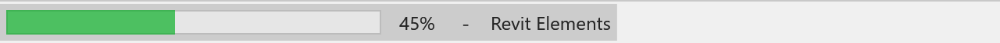
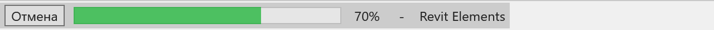
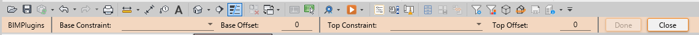

# BIMPlugins.Bars

[](https://github.com/Samveyil/BIMPlugins.Bars)
[](LICENSE.txt)

Library for Revit API developers that adds a **progress bar to the Revit status bar** and lets you place
**custom WPF content in the Revit options bar**.



Target frameworks: `net47` (Revit 2019–2024) and `net8.0-windows` (Revit 2025+).

## Installation

```
dotnet add package BIMPlugins.Bars
```

## Quick start

An external command that writes a value to the **Comments** parameter of every wall in the active document
and shows the progress in the status bar:

```C#
using Autodesk.Revit.Attributes;
using Autodesk.Revit.DB;
using Autodesk.Revit.UI;
using BIMPlugins.Bars;

namespace RevitAddin.Commands
{
    [Transaction(TransactionMode.Manual)]
    public class CommandCheckWalls : IExternalCommand
    {
        public Result Execute(ExternalCommandData commandData, ref string message, ElementSet elementSet)
        {
            Document document = commandData.Application.ActiveUIDocument.Document;

            var walls = new FilteredElementCollector(document)
                .OfClass(typeof(Wall))
                .ToElements();

            using (Transaction transaction = new Transaction(document))
            {
                transaction.Start("Check Walls");

                RevitProgressBarUtils.Run("Checking walls", walls, wall =>
                {
                    wall.get_Parameter(BuiltInParameter.ALL_MODEL_INSTANCE_COMMENTS)?.Set("Checked");
                });

                transaction.Commit();
            }

            return Result.Succeeded;
        }
    }
}
```

## RevitProgressBarUtils

`RevitProgressBarUtils` is the shortest way to show progress: it creates a `RevitProgressBar`, runs the loop
and disposes the bar in one call. Use it when you don't need a cancel button or custom settings.

Loop over a collection:

```C#
RevitProgressBarUtils.Run("Revit Elements", elements, element =>
{
    Console.WriteLine(element.Name);
});
```

Repeat an action a fixed number of times (the action receives the zero-based index):

```C#
RevitProgressBarUtils.Run("Revit Repeat", 100000, i =>
{
    Console.WriteLine(i);
});
```

> The collection is enumerated twice (once to count it, once to process it), so pass a materialized
> collection such as `IList<Element>` or an array rather than a lazy LINQ query.

## RevitProgressBar

`RevitProgressBar` shows a progress bar in place of the native Revit status bar. While it runs, the ribbon
is disabled and a wait cursor is shown. It implements `IDisposable`; always use it in a `using` block so the
status bar and ribbon are restored, even if the operation throws.

The progress bar is meant for long operations executed on the Revit UI thread (for example inside an
`IExternalCommand`). The UI is refreshed by pumping the message loop.

### Run over a collection

```C#
using (var progressBar = new RevitProgressBar())
{
    progressBar.Run("Revit Elements", elements, element =>
    {
        Console.WriteLine(element.Name);
    });
}
```

### Run a fixed number of times

```C#
using (var progressBar = new RevitProgressBar())
{
    progressBar.Run("Revit Repeat", 100000, i =>
    {
        Console.WriteLine(i);
    });
}
```

### Manual loop

```C#
using (var progressBar = new RevitProgressBar())
{
    progressBar
        .SetCurrentOperation("Revit Elements")
        .SetMaximumValue(elements.Count);

    foreach (var element in elements)
    {
        progressBar.Increment();
        Console.WriteLine(element.Name);
    }
}
```

### Unknown amount of work

When the total is unknown, switch the bar to indeterminate mode: it shows a continuous animation
instead of a percentage.

```C#
using (var progressBar = new RevitProgressBar())
{
    progressBar
        .SetCurrentOperation("Searching linked models")
        .SetIsIndeterminate(true);

    while (TryProcessNext())
    {
        progressBar.Increment();
    }
}
```

### Show the bar immediately

By default the bar appears only after 250 ms, so quick operations don't flicker. Set
`InitializeMilliseconds` to `0` to show it right away, and `RefreshMilliseconds` to change how often it repaints.

```C#
using (var progressBar = new RevitProgressBar())
{
    progressBar.InitializeMilliseconds = 0;
    progressBar.RefreshMilliseconds = 100;

    progressBar.Run("Exporting views", views, view => Export(view));
}
```

### Cancel button



Enable the cancel button in the constructor or with `SetHasCancelButton`, then check `IsCancelling()`.
The `Run` methods stop automatically when the button is pressed.

```C#
using (var progressBar = new RevitProgressBar(hasCancelButton: true))
{
    progressBar.Run("Revit Elements", elements, element =>
    {
        Console.WriteLine(element.Name);
    });

    if (progressBar.IsCancelling())
    {
        // cancelled by the user
    }
}
```

In a manual loop call `IsCancelling()` on every iteration: the first call also binds the cancel button.

```C#
foreach (var element in elements)
{
    if (progressBar.Increment().IsCancelling())
        break;
}
```

### Cancel with transaction rollback

Wrap the transaction in the progress bar and decide at the end: if the user pressed **Cancel**,
roll everything back, otherwise commit. This command adds a prefix to the names of all sheets:

```C#
using Autodesk.Revit.Attributes;
using Autodesk.Revit.DB;
using Autodesk.Revit.UI;
using BIMPlugins.Bars;
using System.Linq;

namespace RevitAddin.Commands
{
    [Transaction(TransactionMode.Manual)]
    public class CommandRenameSheets : IExternalCommand
    {
        public Result Execute(ExternalCommandData commandData, ref string message, ElementSet elementSet)
        {
            Document document = commandData.Application.ActiveUIDocument.Document;

            var sheets = new FilteredElementCollector(document)
                .OfClass(typeof(ViewSheet))
                .Cast<ViewSheet>()
                .ToList();

            using (var revitProgressBar = new RevitProgressBar(hasCancelButton: true))
            {
                using (Transaction transaction = new Transaction(document))
                {
                    transaction.Start("Rename Sheets");

                    revitProgressBar.Run("Renaming sheets", sheets, sheet =>
                    {
                        sheet.Name = "ARCH - " + sheet.Name;
                    });

                    if (revitProgressBar.IsCancelling())
                        transaction.RollBack();
                    else
                        transaction.Commit();
                }
            }

            return Result.Succeeded;
        }
    }
}
```

### Methods and properties

| Member | Description |
|---|---|
| `Run(...)` | Executes an action for each item / iteration and advances the bar. Stops on cancel. |
| `SetCurrentOperation(string)` | Text displayed next to the bar. |
| `SetCurrentValue(double)` | Current progress value. |
| `SetMinimumValue(double)` | Value of an empty bar (default `0`). |
| `SetMaximumValue(double)` | Value of a full bar (default `100`). |
| `SetIsIndeterminate(bool)` | Continuous animation without a percentage. |
| `SetHasCancelButton(bool)` | Shows or hides the cancel button. |
| `Increment(int = 1)` | Adds to the current value and refreshes the UI. |
| `IsCancelling()` | `true` if the cancel button was pressed or `Cancel()` was called. |
| `Cancel()` | Requests cancellation; `Run` methods stop after the current item. |
| `InitializeMilliseconds` | Delay before the bar first appears (default `250`). Faster operations are never shown. |
| `RefreshMilliseconds` | Minimum interval between UI refreshes (default `50`). |

All `Set*`, `Run` and `Increment` methods return the same instance, so calls can be chained.

## RevitOptionsBar

`RevitOptionsBar` shows any WPF `FrameworkElement` in the options bar right below the ribbon,
replacing the native options bar while it is shown.



```C#
var panel = new StackPanel { Orientation = Orientation.Horizontal };
panel.Children.Add(new TextBlock { Text = "Offset:", VerticalAlignment = VerticalAlignment.Center });
panel.Children.Add(new TextBox { Width = 80 });

RevitOptionsBar.Show(panel);
```

```C#
RevitOptionsBar.Hide();                          // hide and discard the content
RevitOptionsBar.Hide(saveContent: true);         // hide, keep the content
RevitOptionsBar.Show();                          // show the kept content again
RevitOptionsBar.Hide(TimeSpan.FromSeconds(3));   // hide after a delay (fire-and-forget)
```

Show tool options while the user picks elements, and restore the native options bar afterwards:

```C#
var offsetBox = new TextBox { Width = 80, Text = "100" };

var panel = new StackPanel { Orientation = Orientation.Horizontal, Margin = new Thickness(4) };
panel.Children.Add(new TextBlock { Text = "Offset, mm:", Margin = new Thickness(0, 0, 6, 0), VerticalAlignment = VerticalAlignment.Center });
panel.Children.Add(offsetBox);

RevitOptionsBar.Show(panel);
try
{
    var references = uiDocument.Selection.PickObjects(ObjectType.Element, "Select elements");
    var offset = double.Parse(offsetBox.Text);
    // ... use references and offset ...
}
catch (Autodesk.Revit.Exceptions.OperationCanceledException)
{
    // the user pressed Esc
}
finally
{
    RevitOptionsBar.Hide();
}
```

## Credits

Based on [ricaun.Revit.UI.StatusBar](https://github.com/ricaun-io/ricaun.Revit.UI.StatusBar).

## License

This project is [licensed](https://github.com/Samveyil/BIMPlugins.Bars/blob/master/LICENSE.txt) under the [MIT License](https://en.wikipedia.org/wiki/MIT_License).

---

Do you like this project? Please [star this project on GitHub](https://github.com/Samveyil/BIMPlugins.Bars/stargazers)!
